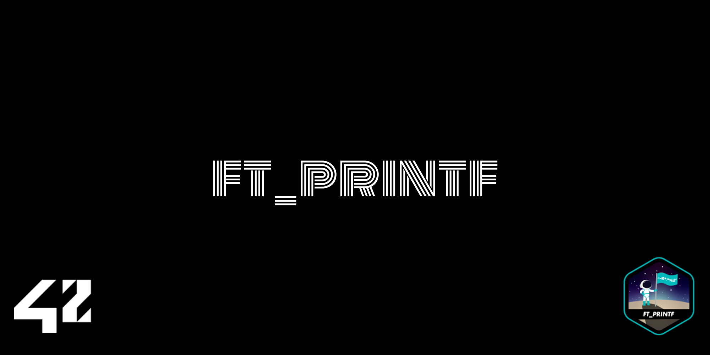

# ft_printf



> *Because `putnbr()` and `putstr()` aren't enough.*

My own implementation of `printf` in C, written for the 42 Madrid common core. It's an exercise in
variadic functions (`va_list`) and number formatting in any base. It builds as a static library,
`libftprintf.a`.

**Grade: 100/100**


## Supported conversions

| Conversion | Prints |
|:-:|---|
| `%c` | A character |
| `%s` | A string |
| `%p` | A pointer, in hexadecimal with the `0x` prefix |
| `%d` / `%i` | A signed decimal integer |
| `%u` | An unsigned decimal integer |
| `%x` / `%X` | An unsigned integer in lowercase / uppercase hexadecimal |
| `%%` | A literal `%` |

Like the real one, `ft_printf` returns the number of characters it printed. Flags, width and
precision (the bonus part) are not implemented.

## Build and use

```bash
git clone https://github.com/VolmerES/ft_printf.git
cd ft_printf
make                 # builds libftprintf.a
```

```c
#include "ft_printf.h"

int main(void)
{
    ft_printf("%s has %d tiles, %x in hex\n", "board", 42, 42);
    return (0);
}
```

```bash
cc main.c -L. -lftprintf
```

| Rule | What it does |
|---|---|
| `make` | Build `libftprintf.a` |
| `make clean` | Remove object files |
| `make fclean` | Remove object files and the library |
| `make re` | `fclean` + `make` |

## Testing

Tested with [Francinette](https://github.com/xicodomingues/francinette): `paco` passes all the
standard tests. The strict mode (`paco -s`) fails a few, because the function doesn't return `-1`
when `write` fails.

---

Made by **Juan Bautista Delorme** (`jdelorme`) at 42 Madrid ·
[Portfolio](https://juandelorme-portfolio.volmer.es) · [LinkedIn](https://www.linkedin.com/in/jdelorme/) · [42 intra](https://profile.intra.42.fr/users/jdelorme)
